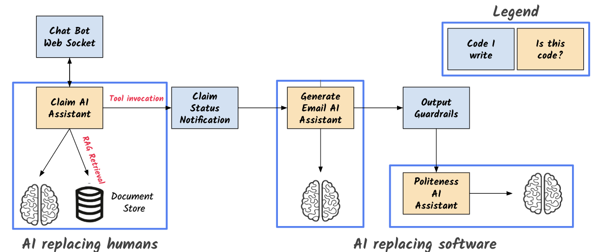
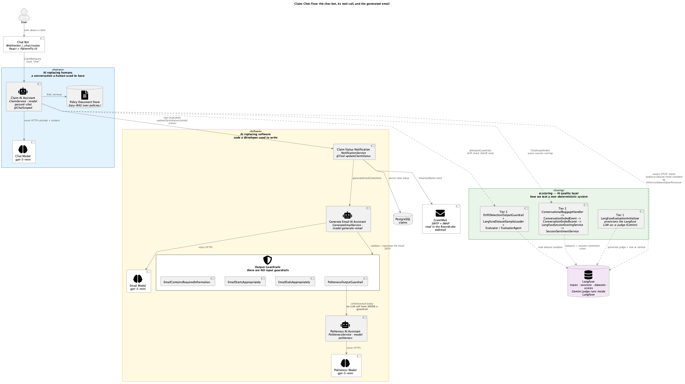
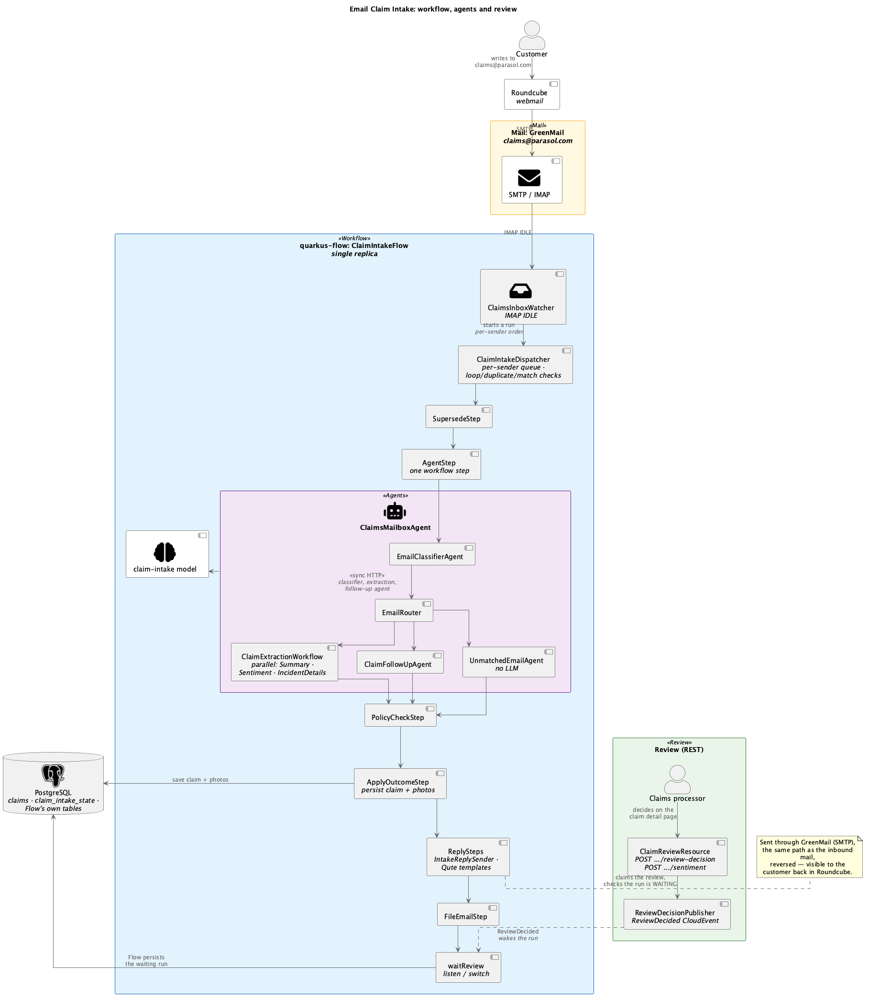

# Non-Deterministic? No Problem!

A demo application — Parasol Insurance — showing how to test and continuously evaluate
non-deterministic AI systems.

It is a single [Quarkus](https://quarkus.io) application (Java 25) with a React/PatternFly frontend
served by [Quinoa](https://docs.quarkiverse.io/quarkus-quinoa/dev/). The business app itself is
deliberately small; the interesting part is the three-tier AI evaluation strategy built on top of
[Langfuse](https://langfuse.com) via the
[quarkus-langfuse](https://github.com/quarkiverse/quarkus-langfuse) extension.

## What it demonstrates

- **An AI chat bot doing RAG** — `ClaimService` (model `parasol-chat`) answers questions about an
  insurance claim, augmented by Easy RAG over a policy PDF
  (`src/main/resources/policies/policy-info.pdf`). Chat runs over a WebSocket (`/_chat/routes`,
  route `chat`), not REST.
- **An LLM tool call with real side effects** — the model may call
  `NotificationService.updateClaimStatus`, which updates the claim in PostgreSQL and then asks a
  second AI service (`generate-email`) to compose a notification email that is actually sent.
- **Output guardrails, including one that calls another LLM** — the generated email passes through
  four output guardrails; the last of them (`PolitenessOutputGuardrail`) delegates to
  `PolitenessService`, an AI service of its own. There are nine output guardrail classes in total (the email four, two
  for drift detection and session scoring, one for the evaluator and two more in the email intake). The app has no LLM
  input guardrails; it does have one *tool* input guardrail, which stops the chat bot acting on a claim still in intake.
- **Three tiers of continuous AI evaluation** — per-trace judging inside Langfuse, session-level
  scoring written in application code, and drift detection wired into a guardrail.
- **An agentic email intake, built as one [quarkus-flow](https://docs.quarkiverse.io/quarkus-flow/dev/)
  workflow** — a customer emails `claims@parasol.com`; an IMAP IDLE watcher picks it up and starts one
  workflow run per email. Inside that run, a `quarkus-langchain4j-agentic` composition (one workflow
  step) classifies and extracts the claim, then the workflow's own steps apply business rules, persist
  the claim, reply, and file the email. See [Email claim intake](#email-claim-intake), below.
- **A human-in-the-loop review, without holding a thread** — before a claim moves to `In Process`, the
  workflow *waits* (a Flow `listen` step, persisted in PostgreSQL) for a claims processor's decision on
  the claim detail page, and applies it once it arrives.

## Architecture



The hand-drawn overview of the business flow, framed around the question this demo keeps asking of
every box: is it "code I write" or is it "is this code?".



The same flow rendered in detail, adding the `ai.scoring` evaluation layer the overview omits: the
browser opens a chat WebSocket, `ClaimService` answers using RAG plus the chat model, and — when the
conversation warrants it — issues a tool call to `NotificationService`, which updates the claim and
hands off to `GenerateEmailService`. The generated email runs the gauntlet of the four output
guardrails before `ReactiveMailer` sends it.



The email claim intake, below `claim-chat-flow.png` as a co-equal part of the architecture: Roundcube
→ GreenMail → the IMAP IDLE watcher → the per-sender dispatcher → `ClaimIntakeFlow`'s own steps, with
the `ClaimsMailboxAgent` topology as one of those steps, PostgreSQL holding the claim data and Flow's
own run state, and the claims processor's review decision waking a waiting run.

Further diagrams cover the evaluation layer and the intake's design:

- [`docs/continuous-scoring-architecture.png`](docs/continuous-scoring-architecture.png) — component
  view of the single Quarkus container, showing the `org.parasol` business layer, the `ai.scoring`
  evaluation layer, the three tiers, and the external systems.
- [`docs/continuous-scoring-sequence.png`](docs/continuous-scoring-sequence.png) — sequence diagram
  of tier-2 session scoring, from `ChatScopeEnded` through the OpenTelemetry flush wait and
  observation polling to the score written back to Langfuse.
- [`docs/design/claim-intake-workflow.png`](docs/design/claim-intake-workflow.png),
  [`claim-intake-states.png`](docs/design/claim-intake-states.png) and
  [`claim-intake-agents.png`](docs/design/claim-intake-agents.png) — the intake's own design diagrams
  (workflow steps, claim states, agent topology); see
  [docs/design/email-claim-intake.md](docs/design/email-claim-intake.md).

There are **seven** PlantUML diagrams in total (four in `docs/`, three in `docs/design/`), all generated
with [PlantUML](https://plantuml.com) from the `.puml` sources committed next to them. Re-render all of
them with [`docs/render-diagrams.sh`](docs/render-diagrams.sh) (needs Java and Graphviz; it downloads the
pinned PlantUML release into a temp directory on first use, and already globs both directories).

## The three evaluation tiers

| Tier | What | Where it runs | Active when |
|---|---|---|---|
| 1 — per-trace | Langfuse-native LLM-as-a-judge relevance evaluator, provisioned at startup by `LangfuseEvaluationInitializer` | Inside Langfuse, using Gemini. The application never calls Gemini itself — it only registers the LLM connection | `quarkus.aiscoring.langfuse.evaluation.initialize-on-startup` (default `true`) |
| 2 — session-level | Custom code: when the chat scope ends, the conversation's observations are pulled back from Langfuse, turned into dataset items, and scored for sentiment. Langfuse has no session-level evaluation target, so this tier exists entirely in application code | In the app, on a background thread (`LangfuseSessionScoringService`) | `quarkus.aiscoring.langfuse.evaluation.session.score-session` (default `true`) |
| 3 — drift detection | `DriftDetectionOutputGuardrail` replays past dataset samples through the `quarkus-langchain4j` evaluation framework and fails the response if the pass rate drops below the threshold | In the app, inline in the guardrail | `quarkus.aiscoring.interaction-mode: drift-detection` |

**Non-obvious:** tiers 2 and 3 are mutually exclusive in practice. `%drift` is the only profile that
arms tier 3, and it inherits `%langfuse-ocp`, which sets `score-session: false` — so when drift
detection is on, session scoring is off.

The full rationale, including which Langfuse platform gaps drove each tier, is in
[langfuse-evaluation.md](langfuse-evaluation.md).

## Prerequisites

- **Java 25**
- **Maven** — use the included wrapper (`./mvnw`); no separate install needed
- **A container runtime** (Docker or Podman) **with Compose**. The Quarkus extensions on the classpath
  start Dev Services for PostgreSQL, Langfuse and LGTM (Grafana/Loki/Tempo/Prometheus) automatically in
  dev and test mode. The mail stack (GreenMail, plus the Roundcube webmail in dev mode) comes from
  `compose-devservices.yml` through Compose Dev Services, which run `docker compose` or `podman compose`.
  With Podman, `podman compose` needs a Compose provider installed (`docker-compose` or `podman-compose`).
  Without Compose, every test fails at startup with `The config property parasol.mail.imap-port is required`,
  because GreenMail's ports never get mapped into the config
- **API keys**, depending on what you want to exercise:

| Variable | Needed for |
|---|---|
| `OPENAI_API_KEY` | The `parasol-chat`, `generate-email`, `politeness` and `claim-intake` models, plus the Easy RAG embedding model |
| `COHERE_API_KEY` | The `session-sentiment` and `judge` models, reached through Cohere's OpenAI-compatible endpoint at `https://api.cohere.ai/compatibility/v1` |
| `GEMINI_API_KEY` | Only when `LangfuseEvaluationInitializer` runs. A *missing* key raises an `IllegalStateException` that is deliberately rethrown and aborts boot; other failures reaching Langfuse (`LangfuseApiException` or anything else) are caught and logged as warnings so startup continues |

Under `-Pollama` the OpenAI and Cohere keys are stubbed to `changeme`, so neither is required.
Under `-Pollama-openai` no keys are stubbed: `session-sentiment` and `judge` still talk to Cohere,
so `COHERE_API_KEY` is still needed if you exercise them (see below).

## Quickstart

```shell
./mvnw quarkus:dev
```

Then:

- **Application**: http://localhost:8080
- **Swagger UI**: http://localhost:8080/q/swagger-ui (always included, even outside dev mode)
- **Quarkus Dev UI**: http://localhost:8080/q/dev-ui
- **Roundcube webmail**: http://localhost:8000. Log in as any address with any password (for example
  `marty.mcfly@email.com`) to read the claim status emails the app sends (see
  [Reading the emails](#reading-the-emails)). Port 8000 is fixed, so dev mode fails to start if something
  else is using it

Dev Services bring up PostgreSQL, Langfuse and LGTM for you automatically, and Compose Dev Services
start GreenMail (SMTP + IMAP) and Roundcube from `compose-devservices.yml`, under every AI profile.
GreenMail keeps mail in memory, so restarting dev mode empties every inbox. Tests start GreenMail
only, except the Playwright UI tests, which also start Roundcube on a random port (never 8000, so they can run
while dev mode does) for the end-to-end test that sends a claim from Roundcube. The application does not
override `quarkus.http.port` anywhere, so it uses the Quarkus default of `8080` in dev mode. Tests
run against port `8081` — the root `pom.xml` sets `BACKEND_API_URL=http://localhost:8081/api` for
both surefire and failsafe.

### Reading the emails

When the chat bot is explicitly asked to update a claim's status, the app emails the claimant from
`noreply@parasol.com`. To read that email:

1. Open http://localhost:8000.
2. Log in with the claimant's email address as the username and **any** password (GreenMail has
   authentication turned off). There's no server to pick.
3. Open the Inbox, and refresh it if the email arrives after you've logged in.

The seeded claims (`src/main/resources/import.sql`) belong to these claimants:

| Claim id | Claimant | Mailbox |
|---|---|---|
| 1 | Marty McFly | `marty.mcfly@email.com` |
| 2 | John T. Anderson | `JAnderson@mail.com` |
| 3 | Jane Doe | `jane_doe@email.com` |
| 4 | Dominic Toretto | `domt@email.com` |
| 5 | Saul Goodman | `bettercallsaul@email.com` |
| 6 | Tyrion Lannister | `tylannister@email.com` |

For example, log in as `marty.mcfly@email.com`, then ask the chat bot to update claim 1's status to
"Approved". The email shows up in Marty's Inbox.

- **Any address works.** Logging in as an address that has never received mail just shows an empty
  Inbox, not an error.
- **One mailbox per browser session.** To switch, log out (top right) and log in as another address,
  or use a private window to keep a second mailbox open alongside.
- **Mail you send from Roundcube also stays inside GreenMail.** It never leaves your machine, so you can
  write to any address, including another seeded claimant.
- **Seeded claimants have their names on their identity.** Logging in as one of the six addresses above sends mail
  as `Marty McFly <marty.mcfly@email.com>`; any other address sends as a bare address. A name you clear in Settings →
  Identities comes back at the next login, and one you change is kept. The names come from
  `src/main/docker/roundcube/config/parasol-identities.php`, which has to follow the claimants in `import.sql`.
- **Mail lives in memory only,** so restarting dev mode empties every mailbox.

The claims REST API provides `GET /api/db/claims` and `GET /api/db/claims/{id}`. Claim images are stored in
PostgreSQL and served by `GET /api/db/claims/{id}/images` (metadata, with a relative URL per image) and
`GET /api/db/claims/{id}/images/{imageId}` (the image bytes). The endpoints return DTOs rather than the database
entities, and a missing claim or image is an RFC 9457 Problem Details `404` (`application/problem+json`). Chat goes
through the chat WebSocket.

The email intake adds four more endpoints: `GET /api/db/claims/{id}/correspondence` (the claim's two-sided email
transcript, oldest first, each message with the photos it carried; `404` for an unknown claim), `GET
/api/db/claims/{id}/review` (the claim's review state — whether a review is open, its requested items, and the full
missing-item checklist), `POST /api/db/claims/{id}/review-decision` (the claims processor's decision; it's
**asynchronous** — it returns `202 Accepted` once the decision is published, not once the workflow has applied it;
`400` for an invalid request body, `404` for an unknown claim or a vanished run, `409` for a claim not open for
review or a stale version, `422` if the reviewed values don't fit the claim) and `POST
/api/db/claims/{id}/sentiment` (re-runs the sentiment agent for a claim under review, `200 { "sentiment": … }`).
None of them require authentication — this is a demo app.

Each claim has a numeric `id` and a separate claim number (`CLM` + 8 digits, e.g. `CLM01000000`). PostgreSQL
generates the number from its own sequence on insert. Claims also have a category (`Single vehicle`,
`Multiple vehicle`, `Theft` or `Other`) and a typed incident date with an optional time.
`src/main/resources/import.sql` seeds six sample claims. See [CLAUDE.md](CLAUDE.md) for how the claim number
is generated and the rules around it.

## Email claim intake

A customer emails `claims@parasol.com`; an IMAP IDLE watcher (`ClaimsInboxWatcher`) picks the email up and starts
one [quarkus-flow](https://docs.quarkiverse.io/quarkus-flow/dev/) workflow run (`ClaimIntakeFlow`) for it. Inside
that run, one workflow step runs a `quarkus-langchain4j-agentic` composition (`ClaimsMailboxAgent`) that classifies
the email and, for a new or still-incomplete claim, extracts the incident details in parallel. The workflow's own
steps then apply the policy-number rule, persist the claim and any photos, reply with a fixed Qute template, and
file the email.

A claim the intake creates or updates moves through three statuses — it never sets `New`:

- **`Pending Information`** — something required is missing; the customer was asked for exactly those items.
- **`Pending Review`** — every required item is present; the workflow is **waiting**, with no thread held, for a
  claims processor's decision.
- **`In Process`** — the claims processor marked the claim ready.

On the claim detail page, a `Pending Review` claim shows a **review panel**: the claims processor can correct any
extracted field, or check **Ask customer** next to any field that's still missing, then click **Submit claim for
processing** (→ `In Process`) or, once something is checked, **Request more information** (→ `Pending Information`).
**Regenerate** re-runs the sentiment agent over the claim's correspondence. The Documents tab shows the claim's full,
two-sided email transcript — every inbound email and every reply the intake sent, each with the photos it carried.

See [docs/email-claim-intake-demo.md](docs/email-claim-intake-demo.md) for a full walkthrough with five scenarios,
and [docs/design/email-claim-intake.md](docs/design/email-claim-intake.md) for the accepted design.

### Configuration

The intake is configured under `parasol.intake.*` (`IntakeConfig`,
`src/main/java/org/parasol/intake/config/IntakeConfig.java`):

| Key | Default | Purpose |
|---|---|---|
| `enabled` | `true` | Whether the claims inbox is watched. **Off only in `%test`** |
| `address` | `claims@parasol.com` | The claims inbox address; replies come from it |
| `imap.host` | `${quarkus.mailer.host}` | The IMAP host (GreenMail by default) |
| `imap.port` | `${parasol.mail.imap-port:3143}` | The IMAP port |
| `imap.user` | `${parasol.intake.address}` | The IMAP login |
| `imap.password` | *(none)* | The IMAP password (GreenMail runs with auth disabled) |
| `folders.processing` / `.processed` / `.failed` | `Processing` / `Processed` / `Failed` | The folders an email moves through |
| `limits.max-body-characters` | `20000` | Most characters of correspondence sent to the LLM (the stored body is never truncated) |
| `limits.max-image-size` | `10M` | Largest image attachment kept |
| `limits.max-images` | `10` | Most image attachments kept per email |
| `watcher.idle-refresh` | `1m` (`10s` in `%dev`) | How often the IMAP IDLE is renewed |
| `watcher.reconnect-delay` / `.max-reconnect-delay` | `1s` / `1m` | Reconnect backoff |
| `metrics.inbox-depth-interval` | `30s` | How often `claim.intake.inbox.depth` is measured |

### Single replica

The intake only works correctly with **one** replica, though nothing enforces that beyond the OpenShift
extension's own default (`quarkus.openshift.replicas: 1`, pinned in `%openshift`). Four in-process mechanisms
assume a single instance: `ReviewDecisionPublisher`'s in-memory event publisher (a decision POSTed to the "wrong"
replica silently succeeds and is never applied), `SupersedeStep`'s in-JVM lookup of the run to cancel, the
per-sender queues `ClaimIntakeDispatcher` keeps in memory, and `ClaimsInboxWatcher`'s process-local lock on the
mailbox. See [#284](https://github.com/edeandrea/non-deterministic-no-problem/issues/284) for the follow-up to lift
this constraint.

### Observability

One claim is one Langfuse **session** — every span of a claim's intake runs carries the same
`gen_ai.conversation.id`, even though one run is still several traces (Flow's persistence emits roughly 58 root traces
per run, all kept and unsampled). The intake never ends a
chat-scope "conversation", so it gets tier-1 per-trace scores only, never a tier-2 session score. `claim.intake.*`
Micrometer meters cover emails, replies, review decisions, failures, latency, the inbox backlog and how often a
reviewer overrides the extracted fields. The Quarkus Dev UI's **Workflows** card (from `quarkus-flow`) draws
`claim-intake` as a typed, branching diagram, including the review wait — the agentic Dev UI does **not** show the
intake's agents (`ClaimsMailboxAgent`'s `MonitoredAgent` support is commented out pending upstream fixes; see
CLAUDE.md). The app ships no custom Grafana dashboard today — dev mode's Grafana shows only the LGTM dev service's
four built-in dashboards, which already cover JVM, HTTP and Agroal; a dashboard charting the `claim.intake.*` meters
above is tracked separately
([#277](https://github.com/edeandrea/non-deterministic-no-problem/issues/277)).

# Langfuse integration

Langfuse's own `LANGFUSE_INIT_*` environment variables cover only basic bootstrapping (org, project,
user, API keys). They do **not** cover evaluators, so at one point these had to be created by hand in
the Langfuse UI (see https://github.com/orgs/langfuse/discussions/8241).

That is no longer the case here. `ai.scoring.langfuse.init.LangfuseEvaluationInitializer` provisions
everything on application startup through the `LangfuseOperations` layer of the
[quarkus-langfuse](https://github.com/quarkiverse/quarkus-langfuse) extension, gated on
`quarkus.aiscoring.langfuse.evaluation.initialize-on-startup` (default `true`). On a `StartupEvent`
it creates-or-reuses:

- a score config for session sentiment
- a Cohere model definition
- a Google AI Studio (Gemini) LLM connection, using `GEMINI_API_KEY`
- a score config for continuous evaluation
- the `Continuous Evaluation Evaluator` LLM-as-a-Judge evaluator
- an evaluation rule binding that evaluator to incoming traces (100% sampling, excluding `SPAN` and
  `EVENT` observation types)

Each step is idempotent — existing entities are looked up by name and reused. That is now the
extension's job: `createIfAbsent` (and `upsert` for the LLM connection) replaced the hand-written
lookup-then-create code this app used to carry. The one call that still drops to the raw
`langfuse.api()` client is re-pointing an existing evaluator at the configured model, because the
operations layer has no `update` for evaluators. Failures are logged as warnings rather than
aborting startup.

For the evaluation gaps that genuinely *can't* be solved through Langfuse today (session-level
scoring, experiment orchestration from Java) and the workarounds implemented in this project, see
[langfuse-evaluation.md](langfuse-evaluation.md).

# Using Ollama

If you would like to use [Ollama](https://ollama.com/) instead, first install/run Ollama on your
machine. Then add `-Pollama` to any Maven command (or `-Dollama` when using the Quarkus CLI):

| Task | Maven | Quarkus CLI |
|---|---|---|
| Building the app | `./mvnw clean package -DskipTests -Pollama` | `quarkus build --clean --no-tests -Dollama` |
| Running dev mode | `./mvnw quarkus:dev -Pollama` | `quarkus dev -Dollama` |
| Running tests | `./mvnw verify -Pollama` | `quarkus build --tests -Dollama` |

To run the app outside dev mode, build it as described above, then run:

```shell
java -Dquarkus.profile=ollama,prod -jar target/quarkus-app/quarkus-run.jar
```

# Using Ollama via the OpenAI endpoint

If you would like to use [Ollama](https://ollama.com/) instead but using the OpenAI endpoint, first
install/run Ollama on your machine. Then use `-Pollama-openai` (or `-Dollama-openai` with the
Quarkus CLI):

| Task | Maven | Quarkus CLI |
|---|---|---|
| Building the app | `./mvnw clean package -DskipTests -Pollama-openai` | `quarkus build --clean --no-tests -Dollama-openai` |
| Running dev mode | `./mvnw quarkus:dev -Pollama-openai` | `quarkus dev -Dollama-openai` |
| Running tests | `./mvnw verify -Pollama-openai` | `quarkus build --tests -Dollama-openai` |

To run the app outside dev mode, build it as described above, then run:

```shell
java -Dquarkus.profile=ollama-openai,prod -jar target/quarkus-app/quarkus-run.jar
```

Both Ollama profiles redirect only the business chat models — `parasol-chat`,
`generate-email`, `politeness` and `claim-intake` (the email intake's model) — plus the embedding model to a local Ollama (`granite4:micro` and
`snowflake-arctic-embed` respectively). The two Cohere-backed models, `session-sentiment` and
`judge`, are **not** redirected: they keep the OpenAI provider pointed at
`https://api.cohere.ai/compatibility/v1`.

`granite4:micro` is a 3B Apache-2.0 model with tool calling and no reasoning mode, picked because
the chat bot invokes a tool and the email guardrails parse structured JSON.

Under `-Pollama`, `generate-email` **and `claim-intake`** are the exception: both use `qwen3:4b` with
reasoning turned off. `EmailEndsAppropriatelyOutputGuardrail` requires the email to end with the standard
closing block **verbatim**, and `granite4:micro` reflows it — as do `llama3.2`, `ministral-3:3b` and
`qwen2.5:3b` — so the guardrail reprompts until it gives up. `qwen3:4b` reproduces it. Reasoning is
disabled because qwen3 otherwise spends roughly 6,000 thinking tokens per email instead of ~140.
`-Pollama-openai` **can't follow this split**: all four of its chat models interpolate their `model-name`
from `parasol-chat`'s Ollama `model-id`, not from their own, so changing `generate-email`'s (or
`claim-intake`'s) id there would only move the Ollama-native leg. It keeps `granite4:micro` throughout
instead — it reaches Ollama over the OpenAI-compatible endpoint, which has no equivalent switch for
reasoning, so a thinking `qwen3:4b` would be far too slow there anyway.

Pull all three before your first Ollama run:

```bash
ollama pull granite4:micro && ollama pull qwen3:4b && ollama pull snowflake-arctic-embed
```

The two profiles differ in what else they touch:

- `%ollama` switches those four to `provider: ollama`, stubs `api-key: changeme` for the OpenAI
  client and for `session-sentiment` and `judge`, and turns off both `score-session` and
  `initialize-on-startup`.
- `%ollama-openai` keeps the OpenAI client and just repoints the same four at
  `http://localhost:11434/v1`. It stubs no API key and disables neither session scoring nor the
  startup initialization.

Easy RAG caches the policy embeddings in `easy-rag-embeddings.json` in the project root and reuses
them on every restart. OpenAI and Ollama embeddings have different sizes (1536 vs 1024 dimensions),
so delete that file whenever you switch between the default profile and an Ollama profile.

CI runs `./mvnw -B clean verify` across both profiles with only a stubbed
`OPENAI_API_KEY: change-me`. That works because `verify` activates the `%test` profile, which is
where `score-session: false` and `initialize-on-startup: false` come from — not from the Ollama
profiles.

Ollama itself is a GitHub service container on `localhost:11434`, with the two models pulled before
the build. Both profiles reach it: `%ollama-openai` points there already, and `%ollama` falls back
to the Ollama extension's default `base-url` because CI passes
`-Dquarkus.langchain4j.ollama.devservices.enabled=false`. That flag is the only CI-specific setting
— the model id lives in `application.yml`, so CI and local runs use the same model.

# Further reading

- [CLAUDE.md](CLAUDE.md) — deep project context: architecture, build/test commands, configuration
  profiles and the gotchas that bite.
- [langfuse-evaluation.md](langfuse-evaluation.md) — the three-tier evaluation design, the Langfuse
  platform gaps behind it and the workarounds chosen.
- [docs/design/email-claim-intake.md](docs/design/email-claim-intake.md) — the accepted, implemented
  design for the email claim intake (workflow, claim states, agent architecture).
- [docs/email-claim-intake-demo.md](docs/email-claim-intake-demo.md) — a five-scenario walkthrough of
  the email claim intake, for dev mode and the cluster.